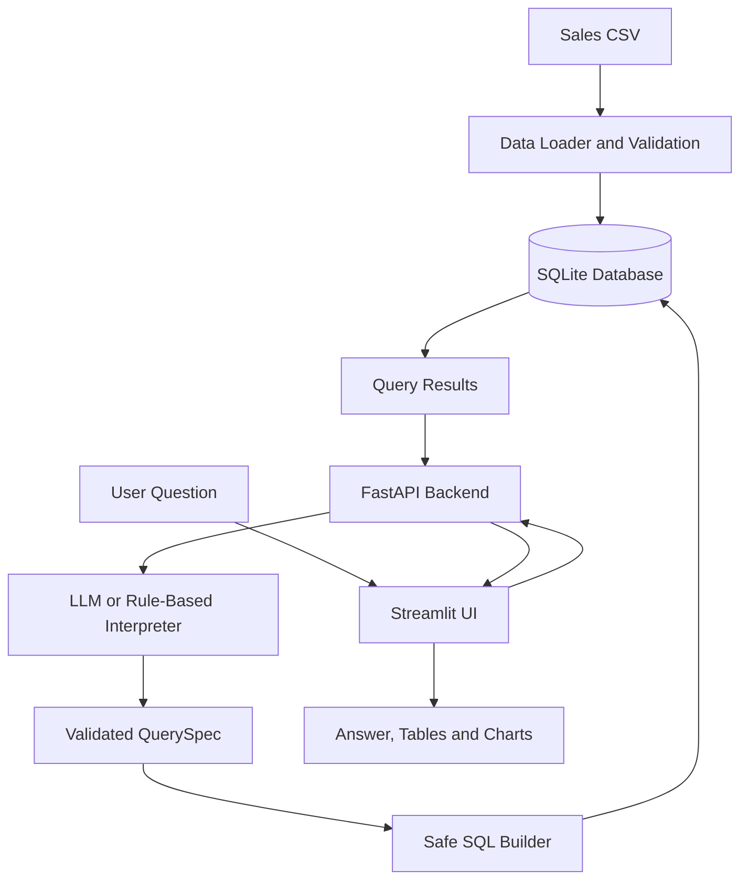

Mini AI Business Intelligence Assistant

A lightweight AI-assisted Business Intelligence application that allows users to ask natural-language questions about sales transactions and receive data-backed answers, supporting tables, and charts.

The application uses Python, FastAPI, SQLite, and Streamlit. It supports LLM-assisted question interpretation with a rule-based fallback.

1. Features

* Load sales transactions from a CSV file into an SQLite database.
* Validate records and handle missing or invalid data.
* Ask natural-language questions about sales performance.
* Calculate business metrics using database queries.
* Display answers with supporting figures, tables, and charts.
* Use an LLM to interpret questions when configured.
* Fall back to rule-based interpretation when the LLM is unavailable.
* Validate query specifications and use controlled SQL generation.
* Run automated tests and independently cross-check analytics.

2. Supported Business Questions

The application supports questions such as:

1. What is the total revenue?
2. Which product generated the highest revenue?
3. What is the monthly revenue trend?
4. Which region generated the highest sales?
5. How did revenue change between two months?

Supported filters, groupings, and date comparisons depend on the implemented query specifications.

3. Architecture

The application follows this workflow:

1. Data ingestion: The CSV loader reads the supplied sales data, validates records, and stores accepted transactions in SQLite.
2. User interface: Streamlit allows users to enter questions and view answers, tables, and charts.
3. API: FastAPI receives requests and coordinates question interpretation and analytics.
4. Question interpretation: The configured LLM or rule-based fallback converts a question into a structured QuerySpec.
5. Validation and query generation: The query specification is validated, and controlled SQL is generated using approved columns and bound parameters.
6. Database execution: SQLite executes the analytics query.
7. Results: The API returns structured results for presentation in the Streamlit interface.

The LLM does not directly generate or execute SQL. The application uses a validated query specification to restrict supported analytics operations.

### Architecture Diagram

4. Technology Stack

* Language: Python
* Backend: FastAPI
* Database: SQLite
* Data processing: Pandas
* Frontend: Streamlit
* AI integration: LLM-assisted question interpretation with rule-based fallback
* Testing: Pytest

5. Project Setup

Prerequisites

* Python 3.11 or another version supported by the project’s dependencies
* pip
* The supplied sales CSV file

Step 1: Create and activate a virtual environment

python -m venv .venv

On Windows PowerShell:

.venv\Scripts\Activate.ps1

On macOS or Linux:

source .venv/bin/activate

Step 2: Install dependencies

pip install -r requirements.txt

Step 3: Configure environment variables

Copy .env.example to .env.

On Windows PowerShell:

Copy-Item .env.example .env

On macOS or Linux:

cp .env.example .env

If LLM integration is required, configure the appropriate API key in .env. The application should remain usable through its rule-based fallback when no key is configured.

Never commit API keys or other secrets to Git.

Step 4: Load the sales data

python load_data.py

This command builds the SQLite database at data/sales.db, according to the current implementation.

Ensure the supplied CSV is placed at the path expected by the loader.

6. Run the Application

Open two terminals in the project directory and activate the virtual environment in both.

Terminal 1 — Start the FastAPI backend

uvicorn app.main:app --reload --port 8000

API documentation, if the default FastAPI documentation routes are enabled:

http://127.0.0.1:8000/docs

Terminal 2 — Start the Streamlit interface

streamlit run frontend.py

Open the local URL displayed in the terminal to use the application.

7. API Usage

The API accepts a user’s natural-language question and returns a structured response. The precise endpoint, request schema, and response fields are defined by the implementation.

For example, a request may contain a question such as:

{
  "question": "What is the total revenue?"
}

Use the actual endpoint and request format implemented in the application when testing or documenting API calls.

8. Data Handling and Business Rules

* Revenue is calculated as quantity multiplied by unit price, minus the discount applied once per transaction line.
* Only orders with status Completed count toward revenue.
* Returned records are retained but excluded from revenue calculations.
* Rows with zero quantity or a missing price are rejected and recorded in rejected_rows with reasons.
* Input dates in DD-MM-YYYY format are stored as ISO YYYY-MM-DD.
* Additional validation and filtering follow the data loader and query implementation.

9. AI Integration and Safety

The application uses AI to interpret natural-language questions rather than relying on an LLM to calculate business metrics.

* The LLM returns a structured query specification.
* Supported metrics, groupings, filters, and column names are validated.
* SQL is built using controlled query logic and bound parameters.
* The LLM does not directly execute SQL.
* The API uses read-only database access, as implemented in the application.
* Unsupported questions should return a clear response rather than an invented business result.
* If the LLM is unavailable or fails, the rule-based interpreter can handle supported question patterns.

10. Testing

Run the automated test suite:

python -m pytest -q

Run the independent pandas-based cross-check:

python crosscheck.py

Recommended test coverage includes:

* Total revenue calculation.
* Highest-revenue product.
* Monthly revenue aggregation.
* Highest-sales region.
* Revenue comparison between months.
* Unsupported or malformed questions.
* Edge cases involving missing values, rejected records, or empty data.

The actual test suite and cross-check results should be verified before submission.

11. Limitations

* The rule-based fallback supports simpler question patterns than the LLM-based interpreter.
* Questions are restricted to the supported metrics, groupings, and filters.
* The current workflow rebuilds the database from one CSV file.
* Results depend on the quality and coverage of the supplied data.
* More complex questions may require additional query specifications and tests.

12. Future Improvements

* Expand natural-language question coverage.
* Add more validation and edge-case tests.
* Improve visualizations and result explanations.
* Support incremental data updates and multiple datasets.
* Add structured logging and improved error reporting.
* Improve evaluation of LLM interpretation accuracy.

13. Project Deliverables

* Application source code.
* README and setup instructions.
* Architecture diagram.
* Automated tests.
* AI development notes describing tools used, development challenges, debugging, and possible improvements.